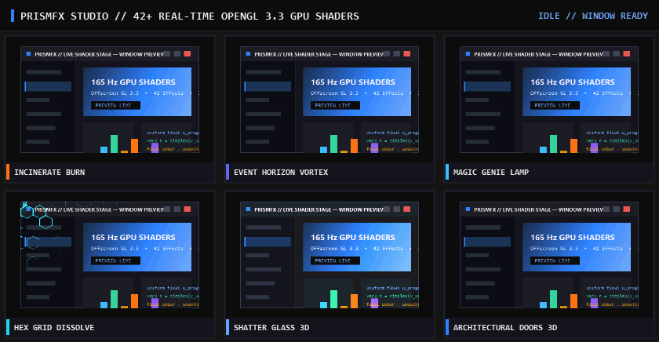
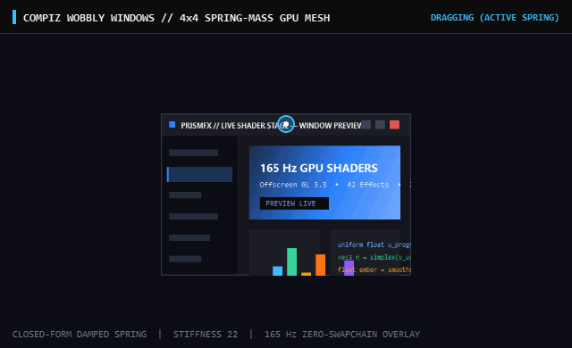
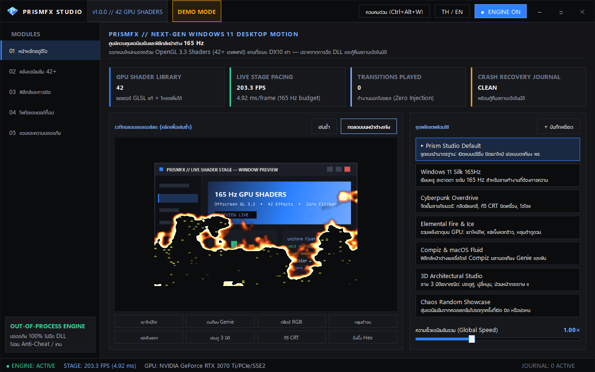
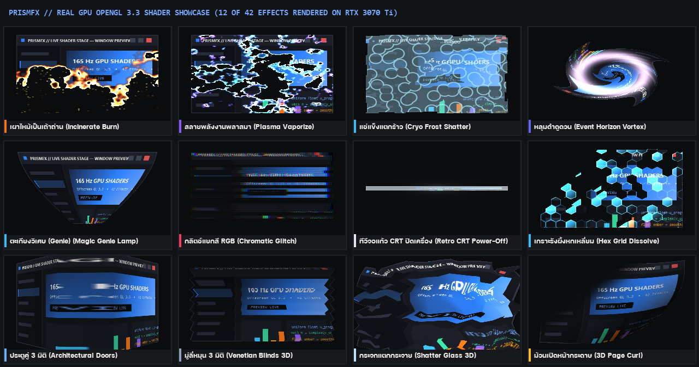
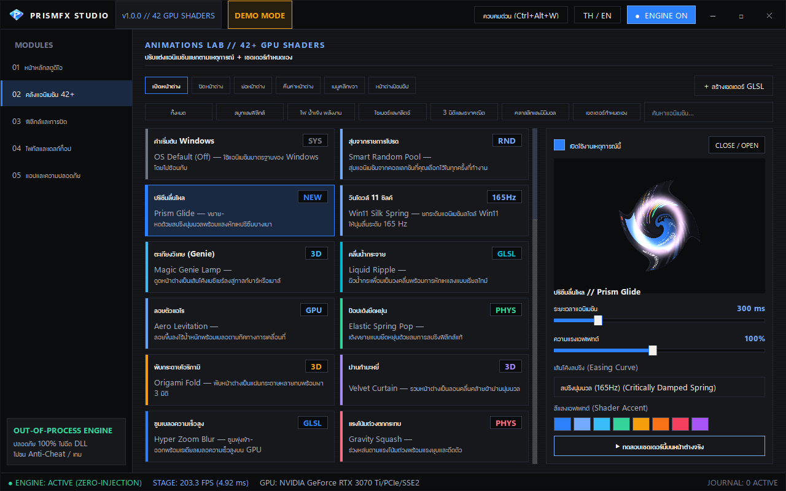
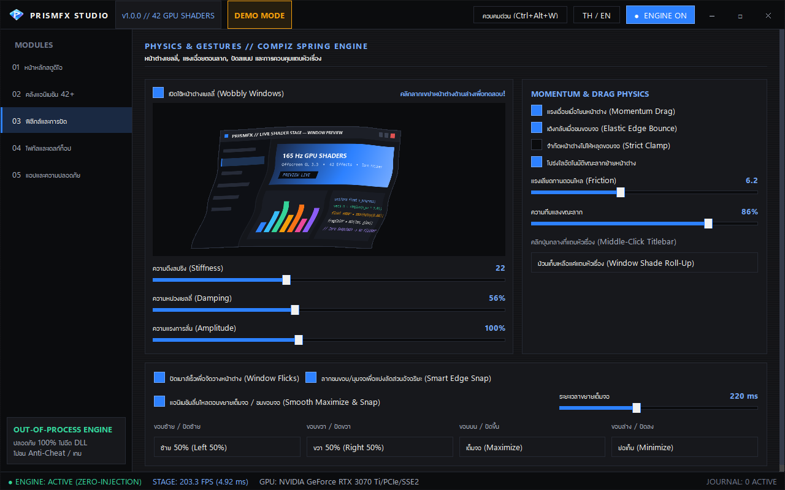
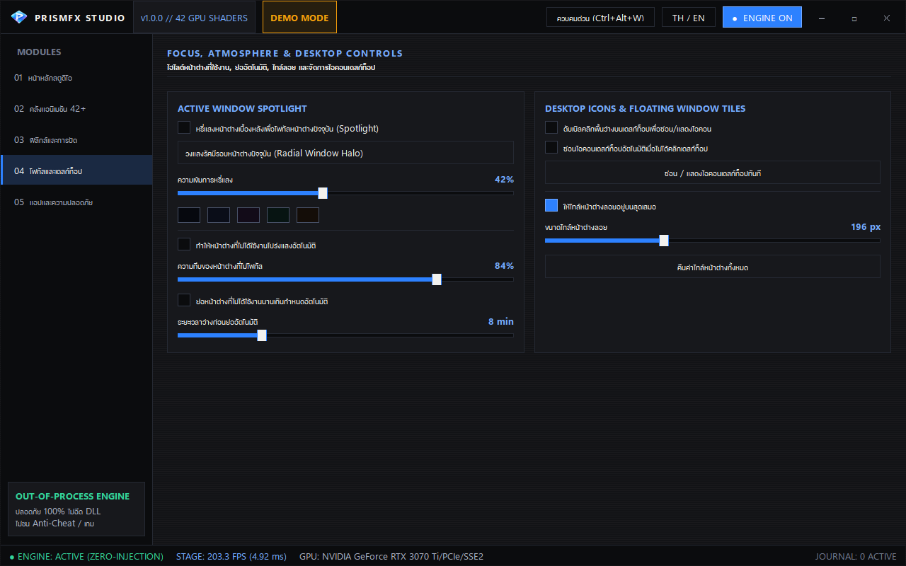
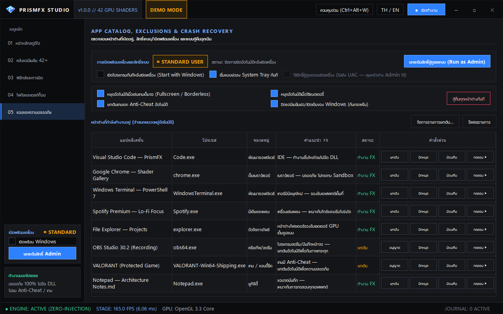
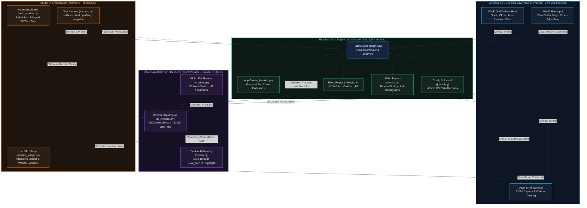

<div align="center">


# PrismFX Studio

**Next-Gen 165 Hz GPU-Accelerated Windows 11 Desktop Motion & Window FX Studio**

*42+ native OpenGL 3.3 Core GLSL shaders · Compiz-style wobbly spring physics · Zero DLL injection · Crash-safe OS recovery*

<p>
  <a href="https://github.com/Tenfoto/PrismFX/releases/latest"></a>
  
  
  
  
  
  
</p>

<p>
  <a href="#-live-gpu-demos">Live Demos</a> •
  <a href="#-studio-interface-gallery">Studio Gallery</a> •
  <a href="#-feature-highlights">Features</a> •
  <a href="#-measured-benchmarks">Benchmarks</a> •
  <a href="#-quick-start">Quick Start</a> •
  <a href="#-custom-glsl-shader-plugins">Custom Shaders</a> •
  <a href="#-architecture-map">Architecture</a>
</p>

</div>

---

**PrismFX Studio** is a clean-room Windows 11 desktop motion utility rebuilt from first principles with **zero DLL injection**, **zero visible OpenGL swapchains** (immune to NVIDIA Overlay / ShadowPlay / MPO flicker), **42+ real-time OpenGL 3.3 Core GLSL shaders**, **closed-form 165 Hz spring-mass physics**, and an **atomic crash-recovery journal** — all powered by a **single external dependency (`PySide6`)**.

---

## 🎬 Live GPU Demos

<div align="center">

### 42+ Bi-Directional OpenGL 3.3 Core Window Shaders
*Rendered directly through PrismFX's real-time offscreen OpenGL 3.3 Core pipeline (Open & Close transitions)*



<br /><br />

### Compiz-Style 165 Hz Wobbly Windows (4×4 Spring-Mass GPU Mesh)
*Closed-form damped spring solver driving a 16-control-point GPU vertex deformation mesh*



</div>

---

## ✨ Why PrismFX Studio?

| Capability | PrismFX Studio v1.0.0 |
| :--- | :--- |
| **Zero DLL Injection** | Runs strictly out-of-process via Win32 `SetWinEventHook` + Raw Input — 100% safe alongside games & anti-cheat. |
| **Zero-Swapchain Anti-Flicker** | Renders via offscreen OpenGL 3.3 FBO → `UpdateLayeredWindow`, avoiding MPO / NVIDIA Overlay (`Alt+Z`) hooks. |
| **42+ Built-in GPU Shaders + Plugins** | Bi-directional Open/Close effects across 5 visual categories plus hot-loadable custom `.glsl` user shaders. |
| **165 Hz Closed-Form Physics** | Unconditionally stable analytical `DampedSpring`, 4×4 `WobblyMesh`, Momentum Inertia, Window Flicks & Smart Edge Snap. |
| **Atomic Crash Recovery** | Every temporary OS mutation (opacity, pin, roll-up, cloaking, hidden icons) is journaled in `recovery_journal.json` and auto-restored. |
| **Bilingual Studio UI (EN / TH)** | Frameless dark architectural studio with instant `TH / EN` switching and proper Thai grapheme-cluster rendering. |
| **Razor-Lean Footprint** | Only **1** external dependency (`PySide6`) — zero `pywin32`, zero `psutil`, zero Electron/Node bloat. |

---

## 🖼️ Studio Interface Gallery

<div align="center">

### Home Studio Dashboard — Live GPU Preview, Presets & 165 Hz Telemetry


<br />

### 12-Shader OpenGL 3.3 GPU Contact Sheet (12 of 42 Built-in Effects)


</div>

<br />

<table>
  <tr>
    <td align="center" width="50%">
      <strong>Animations Lab (42+ Shaders & Custom GLSL)</strong><br /><br />
      
    </td>
    <td align="center" width="50%">
      <strong>Physics & Gestures (Wobbly Sandbox & Edge Snap)</strong><br /><br />
      
    </td>
  </tr>
  <tr>
    <td align="center" width="50%">
      <strong>Focus Spotlight, Desktop Icons & Mini-Tiles</strong><br /><br />
      
    </td>
    <td align="center" width="50%">
      <strong>App Catalog, Anti-Cheat Auto-Exclusions & Recovery</strong><br /><br />
      
    </td>
  </tr>
</table>

---

## 🚀 Feature Highlights

### 🎨 42 Original GPU Shaders (Bi-Directional Open & Close) + Custom GLSL Plugins

<details open>
<summary><strong>Browse All 5 Shader Categories (42 Built-in Shaders + Smart Random Pool)</strong></summary>

| Category | Count | Included OpenGL 3.3 Shaders |
| :--- | :---: | :--- |
| **Spatial & Fluid** | 10 | Prism Glide, Win11 Silk Spring, Magic Genie Lamp, Liquid Ripple, Aero Levitation, Elastic Spring Pop, Origami Fold, Velvet Curtain, Hyper Zoom Blur, Gravity Squash |
| **Elemental & Energy** | 10 | Incinerate Burn *(Simplex FBM fire + embers)*, Plasma Vaporize, Cryo Frost Shatter *(Voronoi)*, Wind Dust Snap, Event Horizon Black Hole, Quantum Rift Portal, Laser Scan Vapor, Aurora Veil, Shockwave Nova, Phoenix Thermal |
| **Cyber & Glitch** | 8 | Chromatic RGB Glitch, Retro CRT Power-Off, Digital Rain Melt, Pixel Sort Drift, Mosaic Deconstruct, Hologram De-Sync, VHS Tape Warp, Hex Grid Dissolve |
| **3D Architectural** | 8 | 3D Doors, Venetian Blinds 3D, Isometric 3D Flip, Accordion Pleat, Shatter Glass 3D, Helix Ribbon Twist, 3D Page Curl, Domino Tile Cascade |
| **Clean & Directional** | 6 | Pure Crossfade, Directional Slide, Architectural Wipe, Corner Anchor Zoom, Orbital Spin, Jelly Wobble Pop |
| **Special & Extensible** | + | Smart Random Pool, OS Default Passthrough, and hot-loadable Custom `.glsl` User Plugins |

</details>

### 🧲 Compiz-Style Wobbly Windows, Momentum & Smart Gestures
- **165 Hz Wobbly Windows:** Interactive 4×4 spring-mass mesh with real-time stiffness, damping, and amplitude tuning.
- **Momentum Inertia:** Throw windows with smooth friction decay, elastic screen-edge bounce, or strict clamping.
- **Drag Semi-Transparency:** Automatic smooth translucency while repositioning windows.
- **Window Flicks & Smart Edge Snap:** Flick gestures and 4-edge/corner snapping (`25% / 33% / 50% / 66% / 75%` + Maximize / Minimize) with smooth dual-texture morph transitions.

### 🎯 Focus, Atmosphere & Desktop Controls
- **Z-Ordered Focus Spotlight:** Radial Window Halo, Cursor Spotlight, or Flat Dimmer to keep focus on the active window.
- **Inactive Window Fade & Auto-Minimize:** Automatically dim unfocused windows or minimize idle windows after a timer.
- **Window Power Tools:** Floating Window Mini-Tiles, Titlebar Middle-Click Roll-Up *(Window Shade)*, Quick Control Bar (`Ctrl+Alt+W`), and Desktop Icon Toggle / Auto-Hide.

### 🛡️ Zero DLL Injection & Atomic Crash Safety
- Strictly out-of-process Win32 hooks — zero process injection, safe with anti-cheat and sandboxed browsers.
- Automatic pause during exclusive fullscreen gaming (`SHQueryUserNotificationState`) and battery power.
- Every temporary OS window mutation is atomically journaled to `recovery_journal.json` and restored cleanly on shutdown, crash recovery, or via `python main.py --restore`.

---

## 📊 Measured Benchmarks

Captured directly on the target Windows 11 24H2 machine via the built-in `--perf-log` and verification harness:

- **Test Environment:** Windows 11 IoT Enterprise LTSC (24H2 Build 26100) · NVIDIA GeForce RTX 3070 Ti @ 164 Hz · Python 3.12 + PySide6 6.12.0 (OpenGL 3.3 Core)
- **External Dependencies:** `1` (`PySide6`) — zero `pywin32`, zero `psutil`, zero Node/bundlers.

| Metric / Suite | Measured Result | Notes |
| :--- | :--- | :--- |
| **Live GPU Stage FPS (`ember_burn` FBM)** | **`165.0 FPS`** | Locked to 164 Hz display VSync (`--perf-log 1.5`) |
| **Frame Pacing (`p50` / `p95` / `p99` / `max`)** | **`6.06 ms` / `6.79 ms` / `7.53 ms` / `7.87 ms`** | Sub-8 ms worst-case frame time |
| **GC Gen-2 Collections During Animation** | **`0`** | Zero garbage-collection micro-stutters |
| **Idle Resource Drop** | **`idle_clock_paused_on_hide: true`** | Preview & overlay clocks pause instantly on hide/minimize |
| **`--selftest` Verification Suite** | **`18/18` Passed** | Physics, journal recovery, hooks & 42/42 GPU shaders (`gl_errors = 0`) |
| **`--uitest` Non-Intrusive UI Suite** | **`16/16` Passed** | Hit-tests, navigation, bilingual toggle, Thai `FC Minimal` check |
| **`--overlay-test` Win32 Layered Suite** | **`3/3` Passed** | Click-through `WindowFromPoint`, `ULW_ALPHA`, exact alpha readback |

---

## ⚡ Quick Start

### Option A — Download Pre-Built Windows Release *(Recommended, No Python Required)*

1. Download **`PrismFX-v1.0.0-Windows-x64.zip`** from [**GitHub Releases**](https://github.com/Tenfoto/PrismFX/releases/latest).
2. Extract the archive and double-click **`PrismFX\PrismFX.exe`**.

### Option B — Run from Source

- **Requirements:** **Windows 11** (64-bit) with OpenGL 3.3+ GPU · **Python 3.12+**

```powershell
# 1. Clone the repository
git clone https://github.com/Tenfoto/PrismFX.git
cd PrismFX

# 2. Install the single dependency
pip install PySide6

# 3. Launch PrismFX Studio
.\run.bat
```

Or run the full automated verification & portable builder:

```bat
:: Run complete automated self-verification suite (selftest, uitest, overlay-test, perf-log)
verify.bat

:: Build reproducible portable bundle in dist\PrismFX-Portable
python build_dist.py

:: Optional: Build trimmed standalone executable via PyInstaller
python build_dist.py --exe
```

### Verification & Utility CLI Flags

| CLI Flag | Purpose |
| :--- | :--- |
| `--demo` | Run with deterministic `DemoWindowBackend` (zero OS side effects) |
| `--profile <dir>` | Isolate config, presets, journal, and FNV-1a single-instance mutex |
| `--minimized` | Start silently in the Windows System Tray |
| `--restore` | Immediately restore all journaled OS window states and exit |
| `--selftest` | Verify core math, physics, recovery journal, and all 42 GPU shaders |
| `--uitest` | Non-intrusive cloaked UI hit-test & navigation verification |
| `--overlay-test` | Verify Win32 click-through overlay styles & GPU alpha compositing |
| `--perf-log [sec]` | Record quantitative 165 Hz GPU frame pacing telemetry |
| `--snapshot <dir>` | Capture non-intrusive PNG screenshots of all UI pages & 12-shader showcase |

---

## 🧩 Custom GLSL Shader Plugins

Add your own OpenGL 3.3 Core fragment shaders without modifying core code — drop a `.glsl` + `.prismfx.json` pair into [`assets/shaders/`](assets/shaders/) (see the included [`chromatic_ripple_custom.glsl`](assets/shaders/chromatic_ripple_custom.glsl) example):

```glsl
// Available uniforms: u_tex, u_progress (0..1), u_raw_t, u_time, u_intensity, u_accent, u_anchor, u_win_size
void main() {
    float p = clamp(u_progress, 0.0, 1.0);
    vec2 center = v_uv - 0.5;
    float dist = length(center);
    float ring = sin(dist * 28.0 - p * 16.0) * exp(-dist * 2.2) * p * 0.045 * u_intensity;
    vec2 dir = normalize(center + 1e-4);

    vec4 col;
    col.r = texture(u_tex, v_uv + dir * (ring + 0.015 * p)).r;
    col.g = texture(u_tex, v_uv + dir * ring).g;
    col.b = texture(u_tex, v_uv + dir * (ring - 0.015 * p)).b;
    col.a = texture(u_tex, v_uv + dir * ring).a;

    col.rgb += u_accent * abs(ring) * 12.0;
    fragColor = vec4(col.rgb * v_shade, col.a * (1.0 - smoothstep(0.25, 1.0, p)));
}
```

---

## 🗺️ Architecture Map

### System Pipeline Flowchart



### Repository Structure

```text
PrismFX/
├── .github/workflows/release.yml  # Automated Windows x64 EXE & Portable Release CI
├── main.py                        # Single-instance FNV-1a mutex, CLI harness, lifecycle hooks
├── run.bat                        # One-click launch
├── verify.bat                     # Full automated verification suite
├── build_dist.py                  # Reproducible portable / trimmed PyInstaller bundle builder
├── tools/make_icon.py             # Procedural multi-res .ico/.png generator
├── assets/
│   ├── prismfx.ico                # Multi-resolution Windows icon
│   ├── prismfx_256.png            # High-resolution brand emblem
│   └── shaders/                   # Hot-loadable custom GLSL shader plugins (.glsl + .json)
├── docs/media/                    # Animated GPU demos (.gif) & Studio screenshots (.png)
└── prismfx/
    ├── core/                      # Headless Core Engine (0 Qt/UI imports!)
    │   ├── win32_api.py           # Direct ctypes Win32/DWM/Shell interop (0 wrapper packages)
    │   ├── backend.py             # IWindowSystemBackend: Win32 <-> DemoWindowBackend
    │   ├── effects.py             # 42 built-in shaders + Custom GLSL plugin scanner
    │   ├── physics.py             # Closed-form DampedSpring, 4×4 WobblyMesh, Flicks & Snap
    │   ├── catalog.py             # Human-centric App Catalog & anti-cheat auto-exclusions
    │   ├── config.py              # Atomic (.part -> fsync -> replace) ConfigStore + 7 presets
    │   ├── journal.py             # Crash-safe atomic OS mutation recovery journal
    │   └── engine.py              # Out-of-process SetWinEventHook + Raw Input coordinator
    ├── render/                    # 165 Hz OpenGL 3.3 Core Renderer & Overlays
    │   ├── shaders.py             # GLSL 330 Core vertex (3D mesh + wobble) & 42 fragments
    │   ├── gl_renderer.py         # Static 32×32 VBO pipeline, zero-swapchain OffscreenGpuEngine
    │   ├── preview_widget.py      # Interactive 165 Hz Shader Stage & Wobbly Drag Sandbox
    │   └── overlay.py             # Click-through DesktopFxOverlay, Spotlight, Tiles, Quick Bar
    ├── ui/                        # Token-First Frameless Dark Architectural Studio
    │   ├── theme.py               # Locked tokens (#121316, 0px corners, FC Minimal 1.32x Thai)
    │   ├── widgets.py             # ScanlineContainer, PanelCard, MetricTile, EffectCard
    │   └── main_window.py         # 5 Studio pages (Home, Lab, Physics, Focus, Apps) + Tray
    └── harness.py                 # Built-in --selftest, --uitest, --overlay-test, --perf-log
```

---

## ⚠️ Known Windows 11 Platform Limitations & Privileges

- **Elevated (Administrator) Target Windows:** Under Windows UIPI (User Interface Privilege Isolation), a standard-privilege PrismFX instance cannot resize, roll up, or change opacity of elevated (Admin) windows; standard user applications work without admin rights.
- **DRM / Hardware-Protected Video Surfaces:** Windows protected media paths (e.g., HDCP Netflix playback) return blank frames from `PrintWindow` by OS security design.
- **Anti-Cheat / Exclusive Fullscreen Games:** Automatically paused via `SHQueryUserNotificationState` and excluded by the built-in App Catalog to preserve zero-latency gaming and anti-cheat compatibility.

---

## 📄 Third-Party Component & Font Notes

- **PySide6 (Qt 6.12):** LGPLv3 / Qt Commercial.
- **Thai Display Typography (`FC Minimal`):** Resolved dynamically from the user's locally installed Windows Fonts directory (`%LOCALAPPDATA%\Microsoft\Windows\Fonts`) and **not** redistributed inside this repository; falls back gracefully to system Windows fonts if unavailable.
